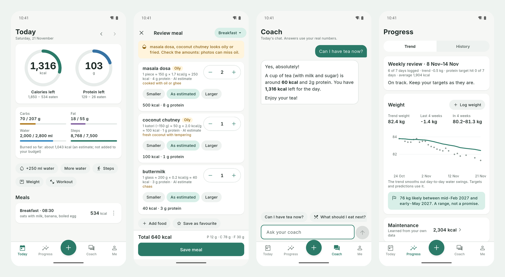
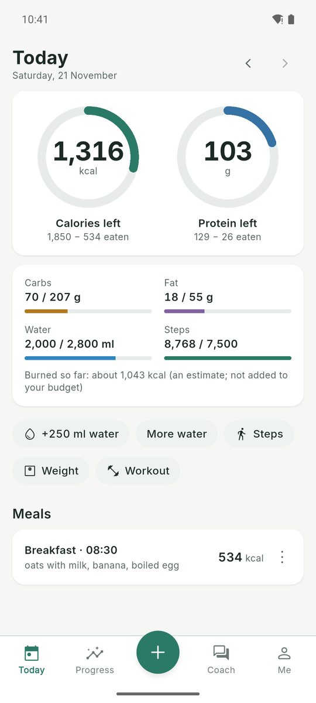
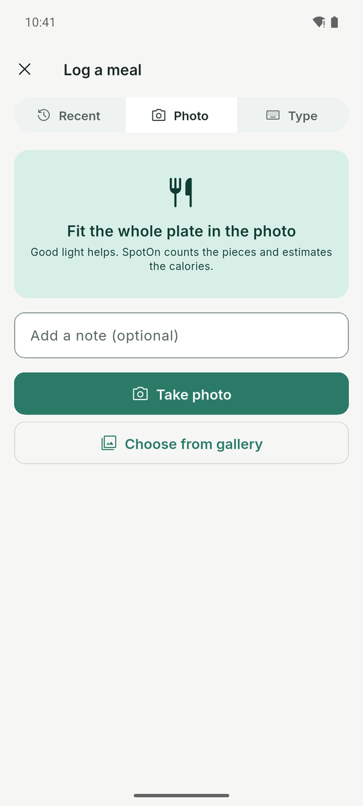
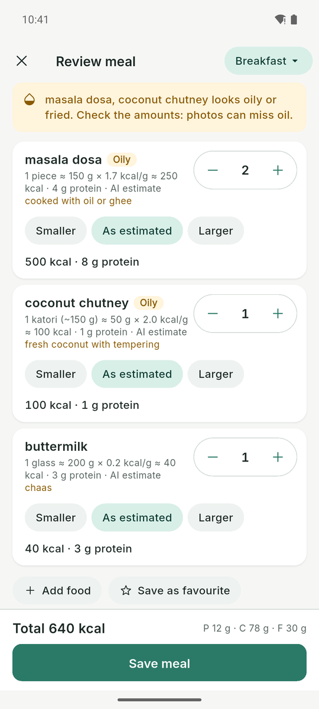
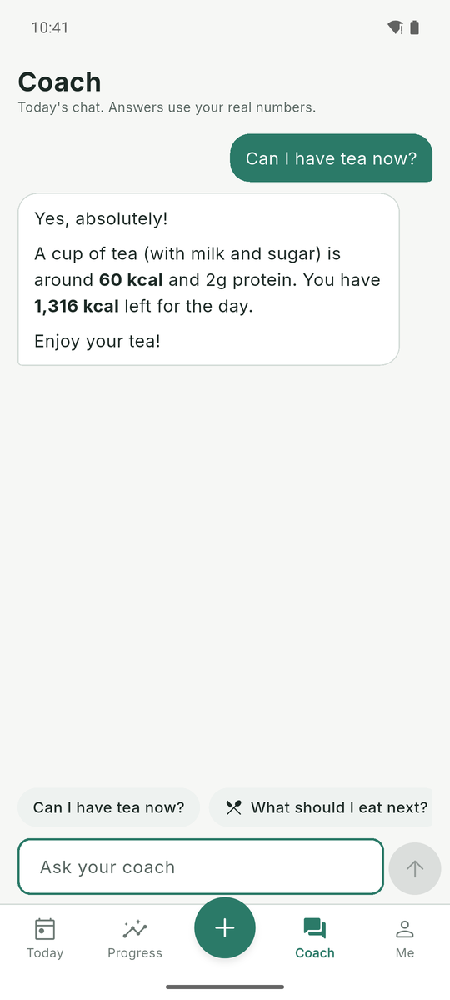
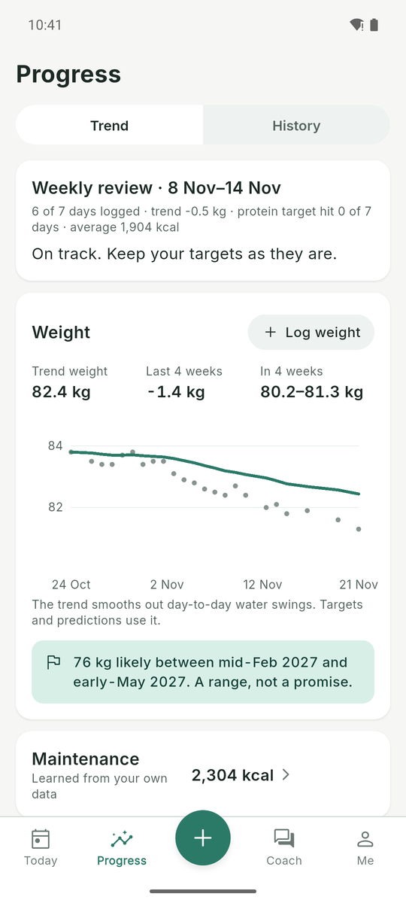
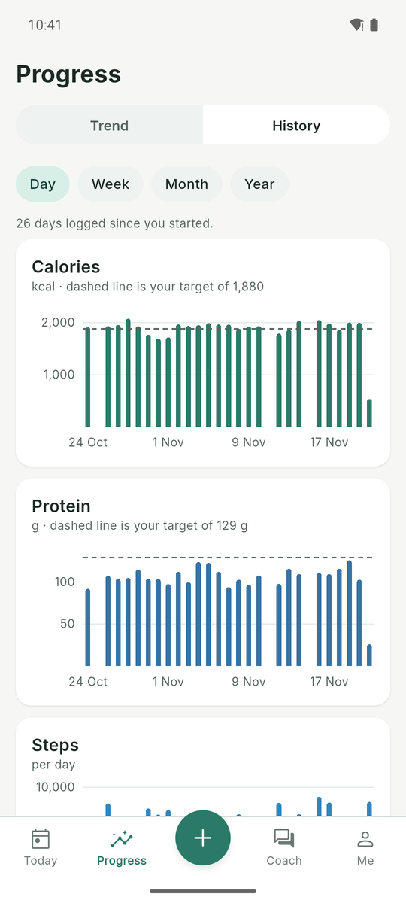
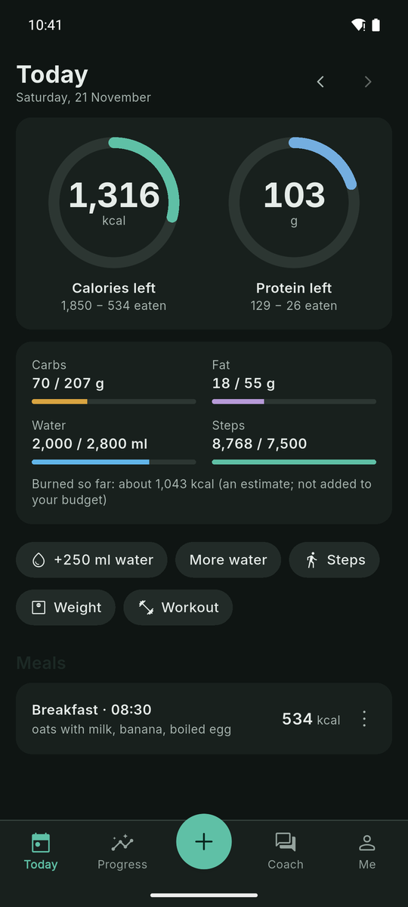
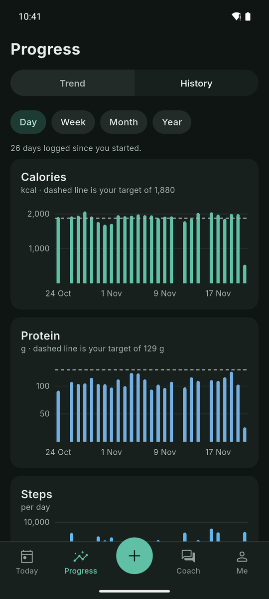

# SpotOn

**An open-source AI fitness coach: snap or type a meal, see what's left today, and ask a coach that answers from your real numbers.**

[](https://github.com/ravikumarmn/spoton-fit/actions/workflows/ci.yml)
[](LICENSE)


<p align="center">
  
</p>

SpotOn is a FastAPI + LangGraph backend and a Flutter app (Android) for fat loss and muscle building. It is designed
around the food people actually eat (idli, dal, roti, eggs) rather than a database of packaged items.

## What it does

- **Log a meal by photo or text.** "2 masala dosa with coconut chutney and a glass of buttermilk" becomes a draft you
  review: counts with − / + steppers, an *Oily* flag where a photo can miss oil, and one tap to correct a value.
  Nothing is saved until you confirm, and values you correct are **remembered** for next time.
- **See what's left today.** Calories and protein left as the focal point, then carbs, fat, water and steps.
- **Ask a coach that knows your day.** "Can I have tea now?" is answered from your actual targets and what you've
  eaten, not from generic advice. It also suggests what to eat next from your own foods and rules.
- **Follow your progress honestly.** A smoothed weight trend, a weekly review with at most one suggested change, a
  maintenance estimate learned from your own data, and predictions given as a **range, never a promise**.
- **Stay safe.** Messages about worrying symptoms or disordered eating get a fixed safety reply before the model sees
  them, and a calorie floor is enforced in code.
- **Own your data.** Export everything (JSON or CSV), change your password, or delete your account from the app.

## Screenshots

<table>
  <tr>
    <td align="center"><br><sub><b>Today</b></sub></td>
    <td align="center"><br><sub><b>Log a meal</b></sub></td>
    <td align="center"><br><sub><b>Review a meal</b></sub></td>
    <td align="center"><br><sub><b>Coach</b></sub></td>
  </tr>
  <tr>
    <td align="center"><br><sub><b>Progress</b></sub></td>
    <td align="center"><br><sub><b>History</b></sub></td>
    <td align="center"><br><sub><b>Dark mode: Today</b></sub></td>
    <td align="center"><br><sub><b>Dark mode: History</b></sub></td>
  </tr>
</table>

<p align="center"><sub>Screenshots are from the Android debug app on an emulator, against a local server with made-up demo data
(<code>scripts/seed_demo.py</code>). The meal review and coach answers are real Gemini responses.</sub></p>

## How it works

The one idea behind the app: **the model estimates, code calculates.**

```
photo / note ──► Gemini (structured output, per food):
                   name, count, unit, grams per unit,
                   nutrition of ONE unit (oil included), oil level, confidence
             ──► code:  totals = count × per-unit;  meal = sum of items;  sanity checks → warnings
             ──► a draft (nothing saved) ──► you edit counts ──► save (the server recomputes totals)
```

"6 boiled eggs" is 6 × the nutrition of one egg, so changing 6 to 4 needs no second model call. There is no food
table and no hard-coded nutrition data; the values are the model's estimates, always shown for review, and tracked
with evals. See [docs/ARCHITECTURE.md](docs/ARCHITECTURE.md) for the diagram and the details.

**Stack:** Python 3.15 · FastAPI (async) · Pydantic v2 · SQLAlchemy + Alembic · LangChain, LangGraph and Deep Agents ·
Gemini · SQLite (dev) / Postgres (prod) · Flutter 3.50 (Riverpod, go_router, Dio) · GitHub Actions.

## Quick start

You need [uv](https://docs.astral.sh/uv/) (a recent version; the project pins Python 3.15.2) and a **Gemini API key**
for the AI features. Accounts, profile, targets, manual meals, water, steps, weight, Today and History work without
one.

```bash
git clone https://github.com/ravikumarmn/spoton-fit.git && cd spoton-fit
uv sync                          # Python 3.15.2 + dependencies
cp .env.example .env             # then set GOOGLE_API_KEY and JWT_SECRET in .env
uv run uvicorn spotonfit.api.main:app --reload     # API on http://127.0.0.1:8000, docs at /docs
```

`/healthz` shows `"llm_configured": true` once your key is picked up, and `/readyz` confirms the database. Try
the API in Swagger UI at `/docs`, or see [docs/API.md](docs/API.md).

**Run the Android app** (needs [Flutter 3.50](https://docs.flutter.dev/get-started/install) and an emulator or phone):

```bash
cd mobile
flutter pub get
flutter run                      # the emulator reaches the API at http://10.0.2.2:8000 by default
```

For a real phone, other server addresses and building an APK, see [mobile/README.md](mobile/README.md). To try the
app with realistic history, run `uv run python scripts/seed_demo.py` against your local API and sign in as the
demo user it prints.

## Status

SpotOn is a working project at **v0.7.0**. Please be aware of the following.

- **Android only.** The Flutter project has an iOS target, but it has never been built or tested, and nothing is
  shipped for iPhone.
- **Estimates, not lab values.** Nutrition comes from a language model. The eval ground truth in
  [`evals/`](evals/) is approximate, and a weighed-meal set that would give a quotable accuracy figure has not been
  built yet ([how to build one](evals/WEIGHED_MEALS.md)).
- **Not medical advice.** SpotOn is for adults and is not a substitute for a clinician or dietitian.
- **Single timezone per server** for "today" (`SPOTON_TZ`); per-user timezones are planned.
- More in [docs/TROUBLESHOOTING.md](docs/TROUBLESHOOTING.md#known-limits-v070).

## Tests

```bash
uv run pytest -q                                   # backend tests; no API key needed (models are stubbed)
uv run ruff check . && uv run ruff format --check .
cd mobile && flutter analyze && flutter test       # Flutter tests, including contract tests on real API responses
```

CI runs all of these, plus a migrations check and an offline eval of the pipeline and the coach's safety routing
(the safety gate must be 100%). More in [docs/DEVELOPMENT.md](docs/DEVELOPMENT.md).

## Documentation

| | |
| --- | --- |
| [Architecture](docs/ARCHITECTURE.md) | Diagram, principles, how nutrition is estimated, progress maths, safety, sessions |
| [API reference](docs/API.md) | Endpoints, errors, coach streaming, examples |
| [Configuration](docs/CONFIGURATION.md) | The `.env` file and every setting |
| [Development](docs/DEVELOPMENT.md) | Tests, migrations, evals, demo data |
| [Deployment](docs/DEPLOYMENT.md) | Optional Cloud Run + Neon pipeline, and what to know before sharing an instance |
| [Mobile app](mobile/README.md) | Running and building the Flutter app |
| [Troubleshooting](docs/TROUBLESHOOTING.md) | Common problems and known limits |
| [Design notes](docs/design/) | The original PRDs, review and plans: a record of decisions that may lag the code |

## Contributing

Issues and pull requests are welcome; see [CONTRIBUTING.md](CONTRIBUTING.md). To report a security problem, see
[SECURITY.md](SECURITY.md).

## License

[MIT](LICENSE) © 2026 Ravikumar Naduvin

Built by [Ravikumar Naduvin](https://github.com/ravikumarmn) ([portfolio](https://ravikumarmn.github.io)).

*AI nutrition values are estimates. Not medical advice.*
