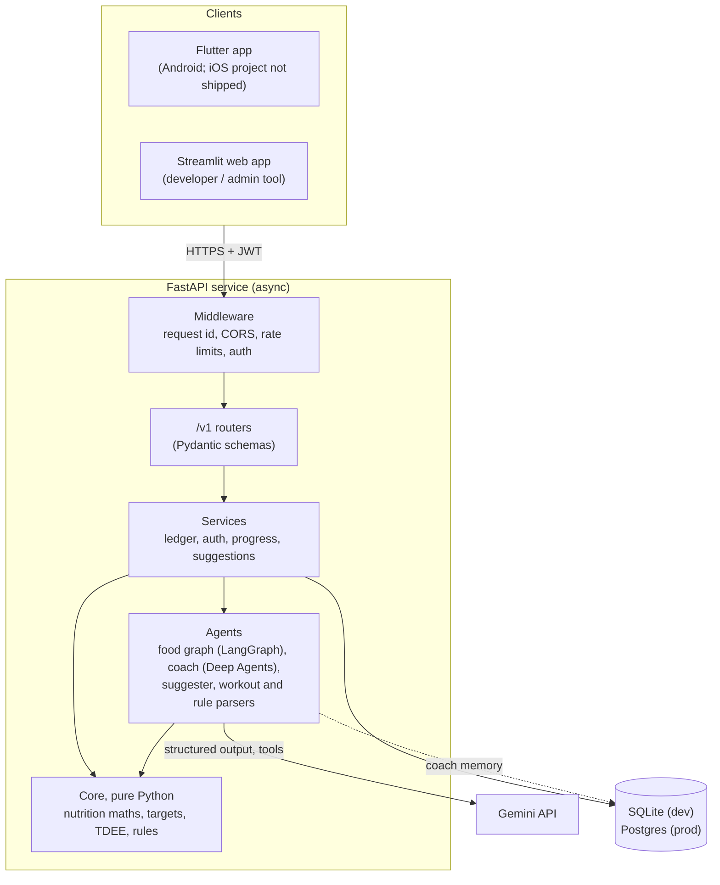

# Architecture

SpotOn is an **API-first** system: a FastAPI service holds all the logic (nutrition maths, targets, safety,
progress), and the apps are thin clients over a versioned REST API (`/v1`).



## Principles

1. **The model estimates, code calculates.** Gemini identifies each food, counts it, and estimates the nutrition of
   **one unit**. Code multiplies and sums. There is no food table and no hard-coded nutrition data.
2. **Safety runs before the model.** Messages about worrying symptoms or disordered eating get a fixed reply; the
   calorie floor is enforced in code.
3. **Nothing is saved without a review.** Photo and text analysis return a *draft*; the user edits counts and saves.
   The server recomputes totals on save.
4. **Estimates are shown as ranges and as estimates.** Predictions are ranges ("likely between mid-Feb and late-May"),
   not promises.
5. **Everything tunable is in one place.** [`config.py`](../src/spotonfit/config.py) holds every threshold and can be
   overridden from the environment.

## Code layout

```
src/spotonfit/
  config.py            all settings and tuning policies (env / .env)
  db.py                SQLAlchemy models (UUID ids, UTC timestamps, refresh tokens)
  observability.py     JSON logs, request ids, hashed user ids, optional LangSmith / MLflow
  core/                pure maths: nutrition (count x per-unit), targets, trend / TDEE
  services/            DB-facing logic: ledger (today / history), auth (tokens), progress, suggestions
  agents/              food_logger (LangGraph), suggester, activity parser, coach (Deep Agents), safety, models
  api/                 app factory, routers (/v1), schemas, errors, rate limits, security
  migrations/          Alembic
mobile/                Flutter app (Android; iOS project is generated but not built or tested)
frontend/              Streamlit client (developer / admin tool)
evals/ tests/ scripts/ docs/
```

## Models, and how nutrition is estimated

All models load through LangChain's `init_chat_model(..., model_provider="google_genai")` ([`agents/models.py`](../src/spotonfit/agents/models.py)), backed by `langchain-google-genai` 4.5 on the official `google-genai` SDK.

| Role | Default model | Thinking level |
| --- | --- | --- |
| Meal photo/text → foods, counts, nutrition per unit, oiliness | `gemini-3.8-flash` | `low` |
| Coach (tool calling) | `gemini-3.8-flash` | `low` |
| Workouts (activity, minutes, MET) and meal suggestions | `gemini-3.5-flash-lite` | `minimal` |

Both IDs were checked against Google's model list (Nov 2026) and are stable. Rules this code follows:

- **No `temperature`/`top_p`/`top_k`.** These are deprecated from Gemini 3.6 on: ignored today, and an error on future models. Use `thinking_level`: `gemini-3.8-flash` accepts `low|medium|high` (**`minimal` is an error**), and `gemini-3.5-flash-lite` accepts `minimal|low|medium|high`.
- **Structured output.** `with_structured_output(...)` uses the recommended `json_schema` method. The field descriptions in [`agents/schemas.py`](../src/spotonfit/agents/schemas.py) are part of the instructions.
- **Images** are sent as `{"type": "image", "base64": ..., "mime_type": ...}` with the text **before** the image. Photos are resized to ≤ 1024 px and stripped of EXIF/GPS. HEIC is sent to Gemini as-is.
- Each call has a **20 s timeout and 2 retries**. Photo analysis has a 15 s budget (then a 504).

### What the model does vs what code does

```
photo / note ──► Gemini (structured output, per food):
                   name, quantity (count), unit, grams_per_unit,
                   per_unit {kcal, protein, carbs, fat, fibre}  ← ONE unit, oil included
                   oil_level (none/light/medium/heavy), remark ("deep-fried, very oily"), confidence
             ──► code:  totals = quantity × per_unit;  meal totals = Σ items
             ──► code:  checks → warnings
                   • calories vs 4·protein + 4·carbs + 9·fat (flags inconsistent estimates)
                   • low confidence → "check this item"
                   • oil_level medium/heavy → listed in oily_items
             ──► draft (nothing saved) ──► you edit counts ──► POST /v1/meals (server recomputes)
```

Example: a photo of 6 boiled eggs. Gemini returns `quantity: 6`, and `per_unit` of about 72 kcal and 6.3 g protein. Code shows **432 kcal and 37.8 g protein**. Change the count to 4 and it becomes 288 kcal, with no second model call.

**There is no food table and no hard-coded nutrition data.** Per-unit values are the model's estimates: right ballpark, not lab values. They're always shown for review before saving, and accuracy is tracked with evals (see [DEVELOPMENT.md](DEVELOPMENT.md)). Workouts work the same way: the model estimates the MET (intensity) for each activity, and code applies `kcal = MET × your weight × hours`.

**What stays in code:**
- Textbook equations: Mifflin-St Jeor and Katch-McArdle for BMR, the MET equation.
- Physical constants: 4/4/9 kcal per gram of protein, carbs and fat.

Every tunable number (deficit %, protein g/kg, floors, step ramp, TDEE window, warning thresholds, rate limits, image sizes) is in `config.py` and can be overridden from `.env`.

## Behaviour details

### Progress (how the numbers are made)
 Weeks run Sunday to Saturday (`WEEK_STARTS_ON`). For every finished week, `services/progress.py` does two things.

- **Learned maintenance.** It estimates maintenance as average intake minus trend change × 7,700 ÷ days, over the 21 days to the week's end. This needs at least 14 logged days and 6 weigh-ins. The trend is the smoothed weight over **all** weigh-ins, so it isn't lagging. The result is blended 70/30 with the previous estimate, moves at most 100 kcal a week, and is saved with an explanation. Targets then use it.
- **Weekly review.** It writes a review with at most one proposal:
  - losing faster than 1% of body weight a week → **+100 kcal** (safety);
  - trend flat for 2 weeks while logging consistently → **+1,500 steps**, or **−100 kcal** if steps are at the cap (never below the floor);
  - inconsistent logging → no change.

  Accepting a proposal adjusts your targets. All thresholds are in `config.py` (`REVIEWS__*`, `ENERGY__*`).

Reviews are generated when you open the app (idempotent) and by the weekly job `python -m spotonfit.jobs.weekly`, which `deploy.yml` deploys as a Cloud Run Job (see [DEPLOYMENT.md](DEPLOYMENT.md)).

### Coach streaming (SSE)

 With `Accept: text/event-stream`, the coach sends `event: status` (it's checking something, e.g. `get_today`), then `event: token` chunks, then `event: done` with the full reply. Errors arrive as `event: error`.

### Safety

 Before the coach model sees a message, `agents/safety.py` checks it against configured phrases (`config.SafetyPolicy`): red-flag symptoms get a "see a doctor / call 112" reply, and signs of disordered eating or self-harm get a supportive reply with the Tele-MANAS helpline (14416). A red-flag match is then confirmed by the small model, so "no chest pain today" or "my dad had chest pain" gets a normal reply; if that check fails or takes over 6 s, the safety reply still goes out. Self-harm and eating-disorder matches are never second-guessed. The calorie floor is enforced in code (`core/targets.py`).

### Sessions

 The access token is a 15-minute JWT (`iss`, `aud` and `jti` are checked). The refresh token is opaque, stored only as a SHA-256 hash, and **rotates on every refresh**. Replaying an old refresh token revokes that whole login session. Logout revokes the session.

### Rate limits

 (counted in memory per process, so production runs one instance with one process; configurable):
- Login/token/register: 5 per minute per IP.
- AI endpoints: 30 per minute and 100 per day per user.
- Everything else: 120 per minute per user.

The API returns `429` with a `Retry-After` header when a limit is hit.
